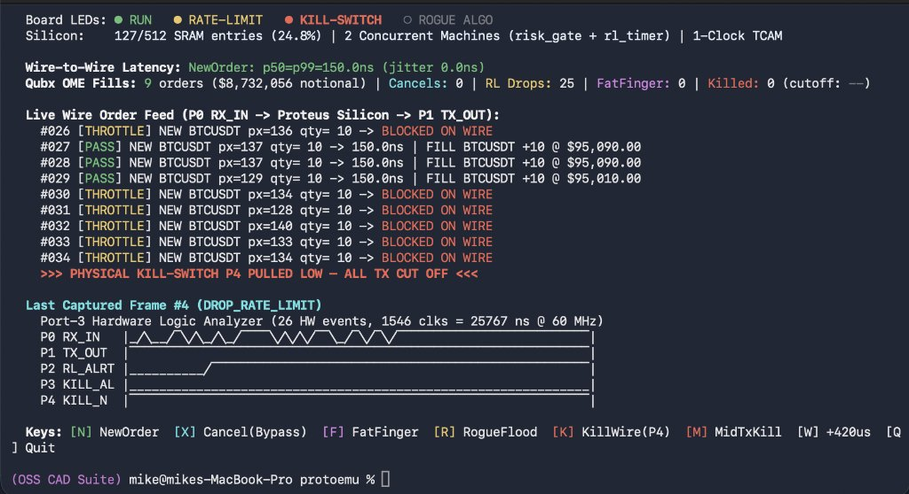
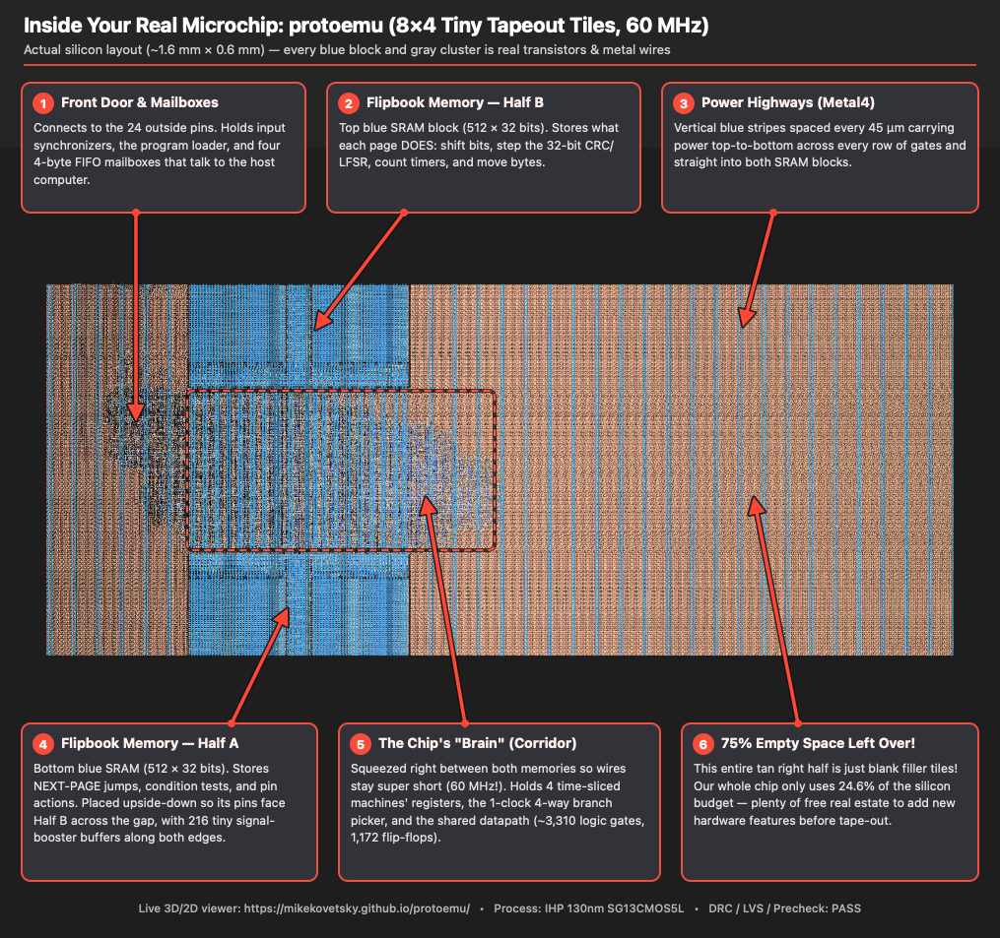

# proteus (`tt_um_mikekovetsky_proteus`)

**Learn it, become it — a 60 MHz silicon protocol chameleon in 28.8% of 1 mm².**

A Tiny Tapeout IHP 130 nm CMOS5L (`8×4` tile) entry for Jane Street's [Protocol Emulator ASIC Competition](https://blog.janestreet.com/protocol-emulator-asic-competition/). Instead of putting a small CPU or PIO clone on silicon, `proteus` is a **single-cycle, SRAM-backed state-table protocol engine** (512 × 64-bit entries across two hard `512×32` IHP SRAMs) with up to 4 concurrent time-sliced machines, a **1-clock 16-rule masked Byte-Class TCAM**, **8.33 ns dual-edge input sampling** (120 MHz effective edge resolution), a **4th physical input pin (`P4` / `in_d`)**, and a **32-entry Port-3 hardware logic analyzer**.



---

## Highlights & Verified Numbers (RTL v2)

| Verification Layer | Measured Result |
|---|---|
| **IHP 130 nm CMOS5L GDS Sign-off** | **PASS @ 60 MHz** — 28.8% effective utilization, **+3.5512 ns** slow setup slack, **+0.0997 ns** fast hold slack, **0 DRC / LVS / antenna / slew / cap / setup / hold violations** across all 3 corners ([CI run](https://github.com/MikeKovetsky/proteus/actions/runs/45097155765)) |
| **Tiny Tapeout KLayout Precheck** | **PASS** — `Precheck passed for tt_um_mikekovetsky_proteus.gds!` |
| **Routed Gate-Level Simulation** | **130 / 130 PASS** (`FAIL=0, SKIP=0`) on extracted IHP 130 nm netlist |
| **Independent 3rd-Party Protocol Oracles** | **6 / 6 PASS** against unmodified `cocotbext-uart`, `cocotbext-i2c`, and `cocotbext-spi` (`test/oracle/`) |
| **Flagship Novelty: *"Learn It, Become It"*** | **82 / 82 PASS** — active black-box SPI/I2C probing through real pins → minimal automaton inference → standalone 5–6 MHz SPI & 400 kHz I2C hardware clones (`learn/`) |
| **Golden-Model Lockstep & Mutants** | **323 / 323 traces** (3,050,238 clocks) match; **21 / 21** RTL mutants killed |
| **Tang Nano 9K FPGA Bitstream** | **PASS @ 27.00 MHz** direct crystal (`Fmax = 28.75 MHz`, 43% LUT4, 35% DFF, 8/26 BSRAM) — unmodified `src/` RTL (`fpga/tang_nano_9k/`) |
| **Proteus × Qubx Hardware Risk Gate** | **4 / 4 PASS** — 150.0 ns NewOrder / 83.3 ns Cancel bypass (**0.0 ns jitter**), 1-clock TCAM & fat-finger guard, 6-clock (100.0 ns) mid-packet physical `P4` kill-switch (`examples/qubx_risk_gate/`) |

<details>
<summary><strong>Annotated 130 nm Die Layout (8×4 Tiles, 28.8% Utilization)</strong></summary>



</details>

---

## Quick Interactive Demo (No Hardware Needed)

Run the live **Proteus × Qubx 60 MHz Hardware Pre-Trade Risk Gate & Port-3 Logic Analyzer** right in your terminal via Verilator:

```bash
source ~/oss-cad-suite/environment
make -C examples/qubx_risk_gate demo
```

Hotkeys: `[N]` NewOrder (`150.0 ns`, 0 jitter) · `[X]` Cancel bypass (`83.3 ns`) · `[F]` Fat-Finger guard · `[R]` Rogue Algo flood · `[K]` Kill-Switch (`P4`) · `[M]` Mid-Packet Kill + Port-3 waveform zoom.

---

## Repository Map

1. **[WRITEUP.md](WRITEUP.md)** — Competition verification write-up, architecture tradeoffs, measured sign-off evidence, and honest AI-usage disclosure ([notes/ai-usage.md](notes/ai-usage.md)).
2. **[docs/architecture.md](docs/architecture.md)**, **[docs/isa.md](docs/isa.md)**, **[docs/programming.md](docs/programming.md)** — Machine architecture, complete RTL v2 ISA/table reference, and step-by-step protocol programming guide.
3. **[src/](src/)** & **[docs/info.md](docs/info.md)** — Synthesizable RTL v2 Verilog (`tt_um_mikekovetsky_proteus`), pinout, host nibble link, loader, and Port-3 trace buffer.
4. **[learn/](learn/)** — *"Learn it, become it"*: active black-box protocol reverse engineering & drop-in hardware cloning (MicroPython-subset host for RP2350).
5. **[examples/qubx_risk_gate/](examples/qubx_risk_gate/)** — Inline 60 MHz pre-trade risk gate & physical kill-switch integrating with [xLydianSoftware/Qubx](https://github.com/xLydianSoftware/Qubx).
6. **[fpga/tang_nano_9k/](fpga/tang_nano_9k/)** — Open-source Gowin bitstream build (`yosys` + `nextpnr-himbaechel` + `gowin_pack`), Pico 2 MicroPython firmware (`pico2_host.py`), and [WIRING.md](fpga/tang_nano_9k/WIRING.md).
7. **[test/](test/README.md)** & **[bakeoff/](bakeoff/README.md)** — Pin-level tests (`make -C test parallel SIM=verilator`), independent third-party oracles (`test/oracle/`), lockstep/mutant suites, and the 3-architecture simulator bake-off.

Licensed under Apache 2.0, the same license as the Tiny Tapeout template.
