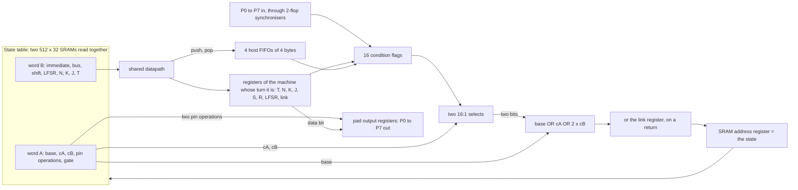

# protoemu architecture

protoemu is a programmable protocol emulator on Tiny Tapeout's IHP shuttle. A program is a **state table**: one
64-bit entry per state, held in two SRAMs. On every clock a machine reads its state's entry, and that one entry
says everything about the clock: which pins to drive, what to count, shift or move, and which of up to four next
states to take, chosen by two conditions. With one machine, the chip decides on every
clock. Up to four machines share the table by taking turns, each with its own registers, at 15 MHz each with four.

Programs are written in a small state-machine language, one line per state and per clock, and compiled to the
table by [compiler.py](../bakeoff/cand_table/compiler.py). [isa.md](isa.md) is the reference for the entry and the
language, and [programming.md](programming.md) walks through writing a new protocol. [info.md](info.md) gives the
pins and the host link.

## Why a table

The chip was chosen in a bake-off ([bakeoff/README.md](../bakeoff/README.md)). Three architectures were written as
cycle-accurate simulators, each with its own assembler, and each ran the same 14 benches over 8 protocols: UART,
SPI, I2C, WS2812, 1-Wire, PS/2, low-speed USB and 10 Mbit Ethernet. All three passed all 14. The others were a
PIO-style processor (one instruction per clock, shift registers, clock dividers) and an event-driven engine
(instructions that wait on edges, timers and patterns).

The table won ([CLAUDE.md, "1. Architecture bake-off"](../CLAUDE.md#1-architecture-bake-off-bakeoff)) because:

1. **It decides on every clock, and a decision does a lot.** One entry branches four ways and runs several
   operations in the same clock. In [eth10_tx.fsm](../bakeoff/cand_table/programs/eth10_tx.fsm) the
   clock between two bytes tests the bit and byte counts, and the next fetches a byte, reloads one counter and
   steps another, while the line keeps exact 3-clock half bits.
2. **It had the smallest logic estimate.** There is no program counter adder:
   the next address is an OR of two condition bits into the entry's base address. The candidates estimated about
   2,600 logic cells for it against 4,800 and 7,000 for the others; only the table was synthesized, and CI maps it to 3,310 multi-input cells besides buffers and inverters.
3. **Its helpers are generic.** One LFSR does parity, CRC-8, CRC-16 and CRC-32. Counters, a shifter, a byte
   compare and edge detection cover bit stuffing, line coding and clock recovery without a block that knows any
   protocol by name.

What it costs: programs are larger (a state is 8 bytes, and a state that is reached from several places is
copied), and the four machines share one decision rate.

## The machine



### One decision per clock

The two SRAMs are synchronous: an address goes in on one clock edge and the entry comes out after it. The design
uses the SRAM's own address register as the state register, so the loop that decides the next state is:

1. The entry is on the SRAM outputs.
2. Its fields `cA` and `cB` each select one of 16 condition flags. Every flag is a flop or a little logic
   on registers and the entry's fields: inputs A, B and C, `edge`, the zero flags of T, K, J and N, the data bit, the CRC match, four
   FIFO flags, and the 8-bit compare `S == imm`.
3. The two selected bits are OR-ed into the low two bits of the entry's `base`: `base | cA | cB << 1`.
4. A 2:1 mux takes the link register instead when the entry is a return.
5. The result is latched as the SRAM address at the end of the clock, and the next entry comes out on the next.

There is no adder and no priority logic in that loop. Deciding on every clock depends on it closing in one
clock. The whole design meets setup, hold, slew and capacitance limits at 60 MHz after place-and-route (see
[Budget](#budget-as-synthesised)).

In the same clock, the entry drives the pins and the datapath: up to two pin operations, one byte on the bus, a
shift, an LFSR step, and updates of N, K, J and T. All of them read the registers as they were at the start of the
clock, and the conditions do too, so a state's actions don't affect its own branch. The one exception is a return
in an entry that also writes the link: it goes to the new value, and the compiler refuses such an entry. Actions
belong to the state and run on every clock spent in it, except that a gated pin operation also depends on a
condition.

### Four machines on one read port

The table has one read port, so up to four machines take turns on it in a fixed rotation. A step of one machine
is a **turn**.

```
turn:           1    2    3    4    5    6    7    8
1 machine:      m0   m0   m0   m0   m0   m0   m0   m0     each decides at 60 MHz
2 machines:     m1   m0   m1   m0   m1   m0   m1   m0     each at 30 MHz
4 machines:     m1   m2   m3   m0   m1   m2   m3   m0     each at 15 MHz
```

The first clock after loading only reads the table. Turns follow it, one a clock, and with two or more machines
m1 has the first.

1. Each machine has its own registers: state, link, T, N, K, J, S, R, the LFSR and its three configured values,
   the flags, and its pin map. The logic that updates them is one copy, shared.
2. With one machine, the address latched at the end of a clock is the state just chosen: the one-clock loop
   above. With several, it is the stored state of the machine whose turn comes next, and the machine that just
   stepped keeps its new state until its next turn.
3. A machine's timer counts its own turns, so its timing stays exact; it only gets coarser. Moving a program
   from one machine to two means halving its clock counts. The 8E1 UART in
   [programming.md](programming.md#7-two-protocols-at-once) runs both ways.
4. The number of machines is set by the image. Three machines decide every third clock, at 20 MHz each.

10 Mbit Ethernet needs all 60 MHz, so it runs alone. Slower protocols share: the self-check runs a 115,200-baud
UART transmitter and receiver, a 1.25 MHz SPI controller and a PS/2 receiver together, one per machine, from
[four_at_once.fsm](../bakeoff/cand_table/programs/extra/four_at_once.fsm).

## The table entry

The table is 512 entries of 64 bits: word A in the first SRAM macro and word B in the second, at the same
address.

```
Word A (control)
  31 30 | 29   | 28 27 | 26 25 24 | 23 22 | 21 20 19 | 18 17 | 16 15 14 13 | 12 11 10  9 | 8 ......... 0
  din   | dsel | gate  | p1op     | p1    | p0op     | p0    | cB          | cA          | base

Word B (datapath)
  31    | 30 29 28 | 27 26 | 25 24 23 | 22    | 21 20 19 | 18 17 16 | 15 ................................ 0
  tload | kj       | nop   | crc      | shift | dst      | src      | imm
```

1. **Control:** the successor block (`base`), the two conditions, two pin operations on logical outputs 0 to 3,
   whether the pin operations depend on `cA` in this same clock (`gate`), where the data bit comes from (`dsel`),
   and what enters the shifter (`din`).
2. **Datapath:** a 16-bit immediate (a timer value, or two 4-bit counter values and a byte), one bus move
   (`src` to `dst`), a shift, an LFSR operation, and the operations on N, K, J and T.

[isa.md, "The table entry"](isa.md#2-the-table-entry) gives every encoding.

## How a state's successors are laid out

Because the next address is `base | cA | cB << 1`, a state's possible successors must sit side by side in the
table: a block of four entries at a multiple of 4 for a state that tests two conditions, a block of two for one
condition, and one entry for none. The compiler builds these blocks, and when one state is a successor of
several others, it copies that state into each block that needs it.

This is the UART transmitter ([uart_tx.fsm](../bakeoff/cand_table/programs/uart_tx.fsm)) as the compiler lays it
out. Its 8 states take 11 entries, because `idle`, `bit` and `bit.hold` each appear twice.

```
                          the block each entry belongs to
entry  state              (whose successors it holds)

  0    idle         -+    idle: wait for a byte on channel 0          base 0, cA = rx0
  1    line9        -+                                                 [no byte, byte]
  2    line10.hold  -+    line10.hold: the start bit's wait           base 2, cA = tz
  3    bit          -+                                                 [waiting, done]
  4    bit.hold     -+    bit.hold: one data bit's wait               base 4, cA = tz, cB = kz
  5    bit           |                                                 [waiting, next bit,
  6    bit.hold      |                                                  waiting, last bit sent]
  7    stop         -+
  8    stop.hold    -+    stop.hold: the stop bit's wait              base 8, cA = tz
  9    idle         -+                                                 [waiting, done]
 10    line10       --    line9 (S=pop0, K=8): one successor          base 10
```

The decision in entry 4, `bit.hold`, is one OR and needs no compare:

```
next = 4 | tz | kz << 1

  tz = 0, kz = 0  ->  4  bit.hold   the bit time is not over
  tz = 1, kz = 0  ->  5  bit        send the next bit
  tz = 0, kz = 1  ->  6  bit.hold   the bit time is not over (a copy of entry 4)
  tz = 1, kz = 1  ->  7  stop       eight bits are out
```

Machine m always starts in entry m, so the compiler places each machine's first state there before anything
else. The listing that prints this layout is described in [isa.md, "The listing"](isa.md#51-the-listing).

## The datapath

Each machine has these registers. Their logic is shared: only the registers are repeated four times.

| Register | Bits | What it does |
|---|---|---|
| T | 16 | Timer. Loaded from the immediate, counts down one per turn in every state, stops at 0 (`tz`). Up to 65,535 turns: 1.09 ms with one machine. |
| N | 16 | Counter, up or down (`nz`). Loaded and read a byte at a time over the bus: lengths, byte counts. |
| K, J | 4 + 4 | Down-counters (`kz`, `jz`): bits in a byte, bytes in a group, 1s since a stuffed bit. |
| S | 8 | Shifter. Its end bit is the data bit `d`, at bit 0 or bit 7 as the machine's `order` says. |
| R | 8 | A second byte, for a value needed twice. |
| LFSR | 32 | Right-shifting, with a configured polynomial, start value and match value. |
| link | 9 | The return address of the one subroutine level. |

### Pins

Each machine names up to four outputs and three inputs, and its configuration maps each to any of the eight
protocol pins P0 to P7 (`uio[7:0]`). Machines may share pins, and one machine may use a pin both ways, as I2C
and 1-Wire do. An entry has two pin operations: drive 0, drive 1, release, the data bit, its inverse, toggle, and
open drain (release for 1, pull low for 0). The data bit comes from the shifter or from the LFSR, so a pin can
send a byte, a CRC, or one wire of a differential pair (`!d` in eth10_tx). The output and output-enable registers
are one pair for all eight pins, shared by the machines.

### Timer and counters

The timer runs in the background: it counts down in every state, so a program can load it at the start of a bit
and do other work (fetch the next byte, step counters) until it runs out. This is how
[ws2812_tx.fsm](../bakeoff/cand_table/programs/ws2812_tx.fsm) keeps every bit exactly 75 clocks long while it
fetches bytes and counts pixels. K and J count bits and bytes, N counts lengths up to 65,535.

### Shifter and byte bus

S shifts one bit per state, in either direction, with a 0, a 1, input A or input B entering. The byte bus moves
one byte per state between S, R, either half of N, a constant, and the host FIFOs. The condition `S == imm`
compares S with a constant byte, which finds a sync byte or an address without a state per bit
([eth10_rx.fsm](../bakeoff/cand_table/programs/eth10_rx.fsm) hunts for the start-of-frame byte this way).

### LFSR and CRC unit

One 32-bit LFSR per machine steps with the data bit or the serial input, clears, loads its start value, or shifts
out. Its polynomial, start value and match value are configuration, so the same unit does parity (a one-bit
LFSR), CRC-8 (1-Wire), CRC-16 (USB) and CRC-32 (Ethernet). A pin can drive its bit 0 to send a CRC, and the
`crc` condition says whether the LFSR equals the match value, which checks a received CRC against its residue.
The compare is registered to keep it out of the decision loop, so the flag is one turn behind the LFSR.

### FIFOs

Four 4-byte FIFOs connect the machines to the host: channels 0 and 3 from the host, 1 and 2 to it. Any machine
can use any channel. Conditions say whether channel 0 or 3 holds a byte and whether channel 1 or 2 has room. A
push into a full FIFO drops the byte and sets the OVERFLOW flag.

## The pads' 3-clock floor

Every input pin goes through a two-flop synchroniser, and every output comes from a register, so a pin reaches
the logic two clocks after it changes and a pin operation reaches the pad one clock after the step. The fastest
reaction is a pin operation gated by the very condition that sees the input (`X=z when CS`): 3 clocks, 50 ns at
60 MHz. A decision that moves to a state which then sets the pin takes 4. With n machines, a machine waits up
to n - 1 clocks for its turn and sets the pin n clocks after deciding, so the gated operation takes 3 to n + 2
clocks and the decision n + 3 to 2n + 2. The self-check ([selfcheck.py](../bakeoff/cand_table/selfcheck.py)) and the
pin tests ([test.py](../test/test.py)) both measure the 3 clocks.

## The host link and the loader

The host is the demo board's RP2350. It talks to the chip four bits at a time on the dedicated pins: a nibble in
on `ui_in[3:0]`, a port select on `ui_in[5:4]`, a write strobe and a read strobe whose every edge moves one
nibble, a nibble out on `uo_out[3:0]`, and four status bits (ROOM, HAS_BYTE, RUNNING, OVERFLOW). Port 0 writes
channel 0 and reads channel 1, port 1 writes channel 3 and reads channel 2, and port 2 is the loader. A byte takes
about 10 clocks.

After reset, the host writes the compiled image to port 2: the machine count, 16 configuration bytes per machine
(pin maps, shift order, LFSR polynomial, start and match values), the entry count, and 8 bytes per entry. The
loader writes each byte straight into its byte lane of the SRAMs, then writes zeros to every entry above the
program, and raises RUNNING. A new program needs a reset, and the chip forgets its program when it is
deselected.

[info.md](info.md) gives the pin-level timing of both, and [isa.md](isa.md#3-machine-configuration-and-the-image)
the image format.

## Budget as synthesised

These numbers come from Yosys on the RTL in [src/](../src/) (`make -C test/synth generic`, run 2026-11-17) and from
Tiny Tapeout's flow in CI.

| Block | Flops |
|---|---|
| Four machines, 230 each: state 9, link 9, T 16, N 16, K 4, J 4, S 8, R 8, LFSR 32, polynomial 32, start value 32, match value 32, flags 6, pin map 21, order 1 | 920 |
| Four FIFOs, 39 each: 4 bytes, two 2-bit pointers, a 3-bit count | 156 |
| Pad output and output-enable registers | 16 |
| Protocol-pin synchronisers, 2 x 8 | 16 |
| Host-pin synchronisers 2 x 8, strobe history 2, reset synchroniser 2 | 20 |
| Host link: nibble phases, the low nibble, the host's dropped-byte flag | 7 |
| Loader: state (3 bits, which Yosys re-encodes one-hot in 6), position 13, count 10 | 29 |
| Run control: running, turn, machine count, read-valid, overflow | 8 |
| **Total** | **1,172** |

1. **Flops: 1,172.** The layout flow's clock tree counts the same 1,172 registers.
2. **Logic: 3,310 multi-input combinational cells** after CI maps it to IHP cells, besides buffers and inverters.
3. **SRAM: 32,768 bits,** both IHP 512x32 macros, all of it the state table.
4. **Layout:** the whole design passes Tiny Tapeout's flow at 8x4 tiles: layout, precheck, and the pin tests on
   the routed netlist ([CI run 44998474402](https://github.com/MikeKovetsky/protoemu/actions/runs/44998474402)).
   Setup, hold, slew and capacitance limits are met at a 16.6 ns clock in all three corners, with 4.0960 ns of
   worst setup slack at the slow corner in that run. A buffer at each of the 216 live SRAM pins keeps the edges
   there inside the library's limits. 97 max-fanout warnings remain and do not fail the build, as
   [CLAUDE.md's R6 line](../CLAUDE.md#requirements-checklist) records.
5. **Where the flops go:** a third of them (384) are the LFSRs' configured polynomial, start and match values.
   They let one unit serve CRCs of up to 32 bits.

## Limits

1. **512 entries for all machines together,** and a state is 8 bytes. Copies add up: the I2C controller's 89
   states take 94 entries (771 bytes). One subroutine level (`call`, `ret`) is the main way to share code.
2. **Two conditions per state.** A decision on three things takes two states, so two clocks.
3. **One byte on the bus, one LFSR operation and one immediate per state,** and two pin operations.
4. **Small counters:** K and J hold 15 at most and S holds 8 bits, so longer words need nested counters and a
   byte per bus move. T reaches 65,535 turns (1.09 ms with one machine); longer times need a loop.
5. **Actions belong to the state.** A waiting state may only set pins, so "do this, then wait" is two states.
6. **The machines share the decision rate.** Two fast protocols at once do not fit; 10 Mbit Ethernet runs alone.
7. **Pins react in 3 clocks at best** (a gated pin operation), 4 otherwise. With n machines the worst cases are
   n + 2 and 2n + 2 clocks.
8. **Three inputs and four outputs per machine.** Only input A has `edge`, and only A and B can be shifted in.
9. **No arithmetic on data:** N counts up and down, and S can be compared with a constant, but nothing adds or
   compares two registers.
10. **A pushed byte is dropped when its FIFO is full,** unless the program tests `tx1` or `tx2` first. The FIFOs
    are 4 bytes deep, so a fast receiver depends on the host keeping up.
11. **A new program needs a reset.**

## Where it lives

| File | What it holds |
|---|---|
| [src/protoemu_table.v](../src/protoemu_table.v) | The table: two IHP SRAM macros side by side |
| [src/protoemu_core.v](../src/protoemu_core.v) | The machines, the shared datapath, the FIFOs' wiring and the loader |
| [src/protoemu_fifo.v](../src/protoemu_fifo.v) | One 4-byte FIFO |
| [src/project.v](../src/project.v) | The top level: synchronisers, the nibble host link, the status pins |
| [bakeoff/cand_table/chip.py](../bakeoff/cand_table/chip.py) | The golden model: the RTL core matches it on every clock of the recorded traces ([test/README.md](../test/README.md)) |
| [bakeoff/cand_table/entry.py](../bakeoff/cand_table/entry.py) | The entry's fields and the image format, shared by the compiler and the model |
| [bakeoff/cand_table/compiler.py](../bakeoff/cand_table/compiler.py) | The compiler |
| [bakeoff/cand_table/programs/](../bakeoff/cand_table/programs/) | The 14 bench programs and the four-machine program |
