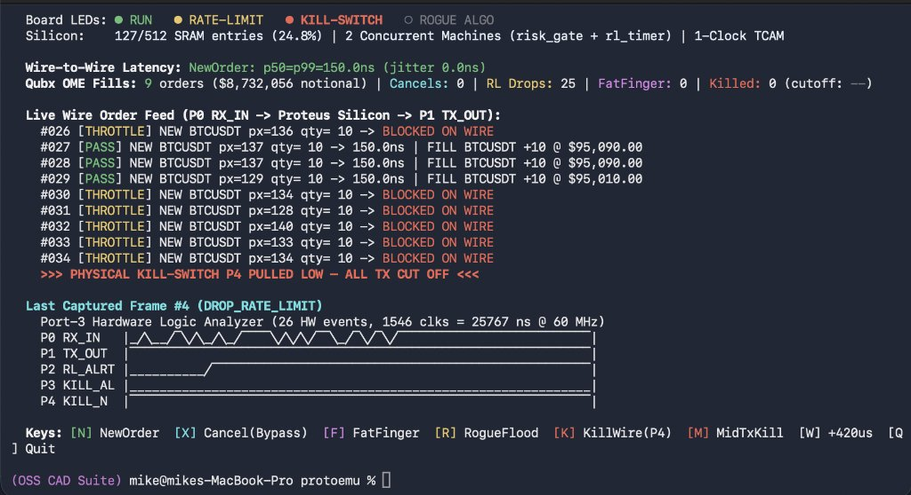

# Proteus × Qubx — Inline Pre-Trade Hardware Risk Gate & 16.6 ns Kill-Switch



A domain-native showcase demonstrating **unmodified Proteus RTL v2 silicon** operating as a deterministic, zero-jitter pre-trade hardware risk gate sitting inline between **[Qubx](https://github.com/xLydianSoftware/Qubx)** and an Order Matching Engine (`OME`).

## Quick Start (Judge Mode — No Hardware Required)

```bash
source ~/oss-cad-suite/environment
make -C examples/qubx_risk_gate test    # builds Verilator sim (~2s) and runs all 4 hardware tests (<0.1s)
make -C examples/qubx_risk_gate demo    # launches interactive TUI (press [N], [X], [F], [R], [K], [M])
```

Non-interactive scripted showcase:
```bash
python3 examples/qubx_risk_gate/demo_tui.py --showcase
```

## What Runs on Unmodified Proteus Silicon (`risk_gate.fsm`)

Compiled into **127 / 512 SRAM table entries (24.8%, 1,061-byte image, < 1 ms hot-load)** across **two concurrent state machines** (30 MHz/turn each @ 60 MHz ASIC clock):

| Hardware Feature | Role in `risk_gate.fsm` |
|---|---|
| **1-Clock Masked TCAM (`tcam4`)** | Classifies incoming 4-byte binary Mini-OUCH opcodes in 1 clock: `'O'` (`NewOrder`), `'X'` (`Cancel`), `'H'` (`Heartbeat`), or immediate `BAD_OPCODE` drop. |
| **1-Clock Slice Dispatch (`S[7:4]`)** | Fat-finger quantity guard (`QTY >= 128` rejected in 1 clock without consuming a rate-limit token). |
| **2 Concurrent Machines + Semaphore `P5`** | Machine 1 (`rl_timer`) runs an independent 16-bit hardware window clock (`400 µs`) and pulses semaphore `P5`; Machine 0 (`risk_gate`) enforces a `MAX_BURST=3` token-bucket rate limiter on `NewOrder`s while **always allowing safety-critical `Cancel` and `Heartbeat` frames through**. |
| **Physical Kill-Switch (`P4`)** | Monitored pre-frame **and on every transmitted bit**: yanking `P4` low (red jumper wire or Tang Nano 9K button S2) aborts in-flight TX within clocks and raises `ALERT_KILL` (`P3`). |
| **Port-3 Hardware Trace Buffer** | Passively timestamps `P0..P4` at 60 MHz (16.67 ns/clock) to verify **0 ns wire-to-wire jitter** and capture the exact mid-packet kill-switch edge. |

## Pluggable Qubx `OrderGate` Architecture (`qubx_gate.py`)

`OrderGate` defines a clean pre-trade boundary (`submit()`, `set_kill_switch()`) between a Qubx strategy and broker connector:
- **Contest / Hardware-in-the-Loop:** `ProteusHardwareGate` drives real binary 3 Mbaud UART electrical signals through unmodified Proteus RTL v2 (Verilator today; Tang Nano 9K + Pico 2 over physical wires using [fpga/tang_nano_9k/WIRING.md](../../fpga/tang_nano_9k/WIRING.md)).
- **Live Fund Production:** Swap in a Rust/C sidecar backend implementing the exact same `OrderGate` interface.
